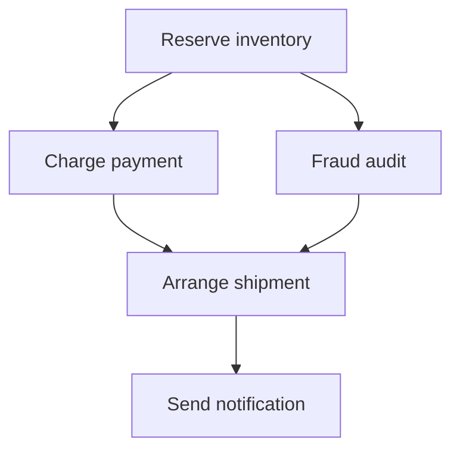

# FlowForge

FlowForge is a durable workflow execution engine built with Java, Spring Boot, and PostgreSQL. It runs dependency graphs reliably across concurrent workers and recovers work after failures.

It is deliberately more than a CRUD service: the project focuses on distributed execution semantics, task leasing, at-least-once delivery, idempotency, retries, and operational visibility.

## What it demonstrates

- Versioned workflow definitions represented as directed acyclic graphs
- Concurrent branches and dependency joins
- Transactional task claims using PostgreSQL `FOR UPDATE SKIP LOCKED`
- Worker leases with automatic recovery after a process crash
- Exponential retries and terminal failure handling
- Idempotent workflow-start requests
- A task-keyed side-effect ledger demonstrating at-least-once execution safety
- Append-only workflow event history
- Prometheus metrics and structured workflow/task log context
- Database migrations, unit tests, containerized integration tests, and CI

## Quick start

Requirements: Docker with Compose.

```bash
docker compose up --build -d
curl --fail http://localhost:8080/actuator/health
```

Register the example workflow:

```bash
curl --fail \
  -H 'Content-Type: application/json' \
  --data-binary @examples/order-workflow.json \
  http://localhost:8080/api/v1/definitions
```

Start an execution:

```bash
curl --fail \
  -H 'Content-Type: application/json' \
  -H 'Idempotency-Key: order-2026-0001' \
  --data-binary @examples/start-order.json \
  http://localhost:8080/api/v1/workflows
```

The returned object contains the workflow ID. Inspect state and its event timeline:

```bash
curl http://localhost:8080/api/v1/workflows/{workflowId}
curl http://localhost:8080/api/v1/workflows/{workflowId}/events
```

The first `reserve-inventory` attempt intentionally fails **after** recording its simulated side effect. The retry returns the original ledger result, proving that the side effect is not repeated.

## Example DAG



## API

| Method | Endpoint | Purpose |
|---|---|---|
| `POST` | `/api/v1/definitions` | Validate and register a versioned DAG |
| `POST` | `/api/v1/workflows` | Start a workflow; accepts `Idempotency-Key` |
| `GET` | `/api/v1/workflows/{id}` | Read workflow and task state |
| `GET` | `/api/v1/workflows/{id}/events` | Read the ordered execution history |
| `POST` | `/api/v1/workflows/{id}/cancel` | Cancel non-terminal work |
| `GET` | `/actuator/prometheus` | Scrape application and engine metrics |

Built-in handlers are `echo`, `delay`, `fail-n-times`, and `idempotent-operation`. Real integrations should implement `StepHandler` and use the task ID as the downstream idempotency key.

## Testing

Run all tests when Maven and Docker are installed:

```bash
mvn verify
```

The integration test launches PostgreSQL through Testcontainers and verifies DAG joins, retry behavior, post-commit failure recovery, and workflow-start idempotency. A dependency-free core check is also available:

```bash
./scripts/check-core.sh
```

## Observability

Start Prometheus with the optional profile:

```bash
docker compose --profile observability up --build -d
```

Prometheus is available at `http://localhost:9090`. Useful metrics include:

- `flowforge_tasks_duration_seconds`
- `flowforge_tasks_succeeded_total`
- `flowforge_tasks_failed_attempts_total`
- `flowforge_tasks_recovered_total`

## Engineering decisions

The first milestone uses PostgreSQL as both durable state and work queue. This keeps state transitions transactional and lets the project demonstrate its guarantees clearly. Kafka is a scale-out option once claim-table contention is measured; adding it prematurely would introduce dual-write failure modes without improving correctness.

Read [architecture.md](docs/architecture.md) for execution guarantees and the failure matrix, [roadmap.md](docs/roadmap.md) for planned milestones, and [interview-guide.md](docs/interview-guide.md) for the design trade-offs worth discussing in an SDE-2 interview.

## Current scope

This is a strong milestone-one engine, not yet a multi-tenant hosted service. Authentication, tenant isolation, handler heartbeats, distributed tracing, Kafka notification, retention policies, and a web console remain explicit roadmap items. Do not expose the current API directly to the public internet.

## Resume bullet template

After running your own benchmark, replace the placeholders with measured values:

> Designed a durable workflow engine using Java, Spring Boot, and PostgreSQL, implementing DAG scheduling, `SKIP LOCKED` task leasing, idempotent execution, exponential retries, and crash recovery; sustained **[measured throughput]** tasks/second with **[measured p95]** scheduling latency across **[worker count]** workers.
