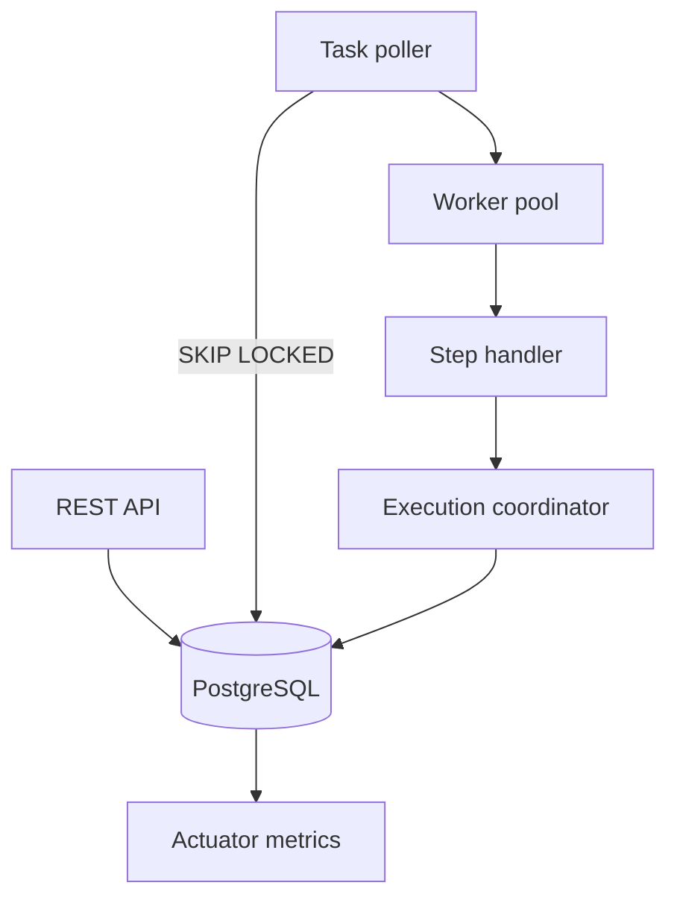
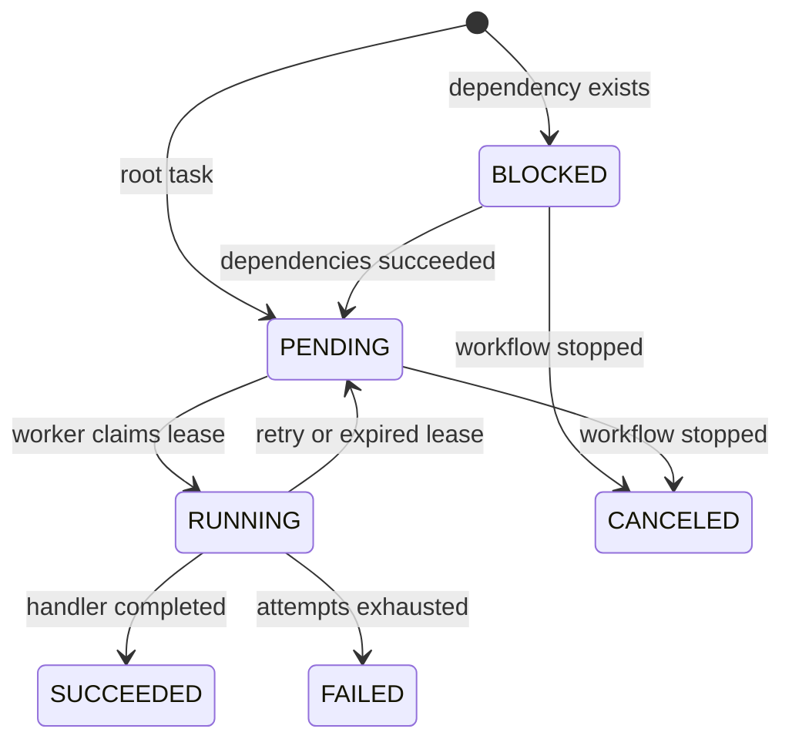

# Architecture

## Execution model

FlowForge stores the workflow definition, instance state, task state, leases, and event history in PostgreSQL. The database is the source of truth. Workers are stateless and may be added or removed without moving ownership data.

## State transitions

## Correctness boundaries

### Task claiming

A worker selects one eligible task using `SELECT ... FOR UPDATE SKIP LOCKED` and updates it to `RUNNING` in the same transaction. This prevents two workers from owning the same live lease.

### Delivery guarantee

Execution is **at least once**. A worker can perform an external side effect and die before recording success. Step handlers therefore need idempotency. The included `idempotent-operation` handler records a task-keyed result and demonstrates recovery from a simulated post-commit crash.

### Lease recovery

Each claim has an expiry. The recovery loop returns expired `RUNNING` tasks to `PENDING`. A late worker cannot commit task success because every completion update checks both the current status and the lease owner.

### DAG scheduling

Definitions are validated using a topological traversal. A blocked step becomes pending only after every declared dependency is `SUCCEEDED`. Independent branches can run concurrently.

### Workflow idempotency

Clients may supply `Idempotency-Key` when starting a workflow. The database unique constraint is the final concurrency guard; repeated requests return the original workflow.

## Failure matrix

| Failure | System response | Remaining limitation |
|---|---|---|
| Handler throws | Exponential retry, capped at five minutes | No per-error retry policy yet |
| Worker dies before side effect | Lease expires and another worker retries | Recovery latency equals lease timeout |
| Worker dies after side effect | Handler must reuse task idempotency key | External systems must support deduplication |
| API receives duplicate start | Existing workflow is returned | Key scope is global in this MVP |
| One branch exhausts retries | Workflow fails; pending work is canceled | Running sibling tasks finish but cannot commit after cancellation |
| Database unavailable | Work pauses without losing persisted state | No multi-region database strategy |

## Scale path

The PostgreSQL queue intentionally keeps milestone one understandable and testable. When claim-table contention becomes measurable, separate queue notification from durable state: publish task-ready notifications through Kafka, retain PostgreSQL as the authority, and reconcile missed messages with an outbox sweeper. This avoids making Kafka itself the workflow database.
